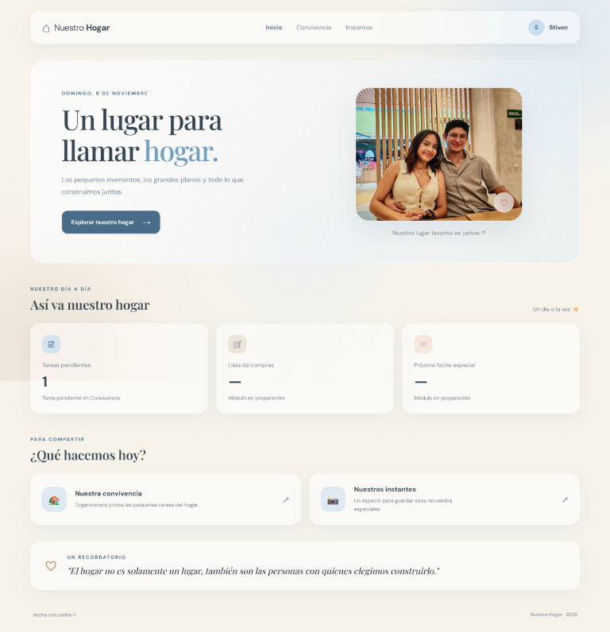
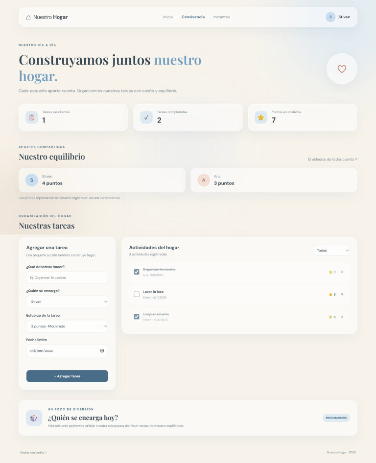
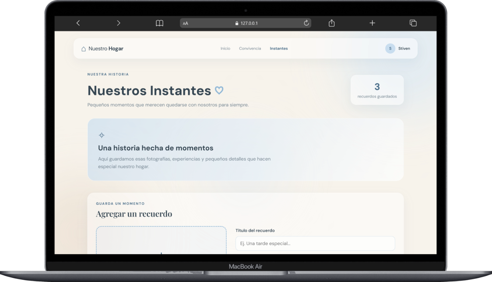

# Nuestro Hogar

Aplicación web para organizar la convivencia y conservar recuerdos compartidos.
Este proyecto académico está construido con HTML, CSS y JavaScript, sin
frameworks ni servidor backend.

## Estado actual

La versión inicial incluye tres páginas:

- **Inicio:** bienvenida, navegación y resumen de tareas pendientes.
- **Convivencia:** creación, asignación, seguimiento y filtrado de tareas.
- **Nuestros Instantes:** registro de recuerdos con fotografía, descripción y
  fecha.

Las tareas y los datos de los recuerdos se guardan en `localStorage`. Las
fotografías se guardan en IndexedDB. La información permanece en el navegador
actual y no se sincroniza entre dispositivos.

## Cómo ejecutar

1. Descarga o clona el proyecto.
2. Abre `index.html` en un navegador moderno.
3. Para trabajar desde VS Code, también puedes abrir la carpeta con una extensión
   de servidor local.

No se requiere instalar dependencias ni ejecutar un proceso de compilación.

## Estructura

```text
Nuestro Hogar/
├── assets/
│   └── images/
│       ├── foto-pareja.jpg
│       └── README.md
├── docs/
├── pages/
├── scripts/
├── styles/
├── index.html
├── README.md
└── .gitignore
```

Consulta [`docs/ARQUITECTURA.md`](docs/ARQUITECTURA.md) para conocer las
responsabilidades de cada archivo y [`docs/FUNCIONALIDADES.md`](docs/FUNCIONALIDADES.md)
para ver el alcance de la versión actual.

## Vistas del proyecto

| Inicio | Convivencia | Instantes (mockup) |
| --- | --- | --- |
|  |  |  |

La vista de Instantes es un mockup de referencia; las otras dos imágenes muestran
la aplicación. En [`docs/screenshots/`](docs/screenshots/) se pueden abrir a
tamaño completo.

## Manual de uso

Consulta el [manual de uso](docs/MANUAL-DE-USO.md) para aprender a crear tareas,
guardar recuerdos y entender dónde se conserva la información.

## Tecnologías

- HTML5 para la estructura.
- CSS3 para la presentación adaptable.
- JavaScript nativo para la interacción y manipulación del DOM.
- `localStorage` para tareas y metadatos de recuerdos.
- IndexedDB para las fotografías.
- Google Fonts para las tipografías de la interfaz.

## Alcance y privacidad

Los datos se guardan localmente en el navegador. Borrar los datos del sitio o
cambiar de navegador o dispositivo puede hacer que dejen de estar disponibles.
La aplicación todavía no tiene cuentas, backend ni sincronización compartida.
La fotografía de portada se incluye en el repositorio público, por lo que puede
ser vista y descargada por otras personas.

La visión del producto, su arquitectura y los cambios planeados se describen en
la carpeta [`docs/`](docs/).
